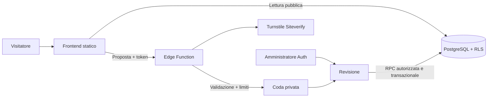

# Architettura e modello linguistico

## Flussi

Il frontend è un’applicazione statica React/TypeScript costruita con Vite. `HashRouter` rende riapribili le schede su GitHub Pages senza riscritture del server. Il frontend usa solo una chiave Supabase pubblica; la visibilità dei dati dipende da RLS e dalle procedure del database.

## Entità e identità

| Tabella                      | Responsabilità                                                                                           |
| ---------------------------- | -------------------------------------------------------------------------------------------------------- |
| `signs`                      | Identità UUID indipendente dalla glossa; revisione e stato di pubblicazione                              |
| `glosses`                    | Denominazioni alternative; stessa glossa ammessa per segni differenti                                    |
| `variants`                   | Forme di citazione o varianti del singolo segno                                                          |
| `annotations`                | Parametro, valore, mano, fase e stato epistemico della variante                                          |
| `vocabulary_fields`          | Registro dei percorsi, gruppo, cardinalità e stati consentiti                                            |
| `vocabulary_terms`           | Valori per percorso, fonte, etichetta e revisione del vocabolario                                        |
| `verb_profiles`              | Classe controllata, accordo, flessione e direzione                                                       |
| `examples`                   | Frasi, traduzioni, contesto e modificazioni osservate                                                    |
| `realizations`               | Annotazione specifica di un esempio, distinta dalle varianti lessicali; riserva per media e allineamento |
| `bibliographic_references`   | Titolo, sezione verificata e URL per una scheda                                                          |
| `proposals`                  | Documento originale e versione revisionata; email privata, stato e revisione di base                     |
| `revisions`                  | Attore, motivo, azione e snapshot prima/dopo                                                             |
| `admin_profiles`             | Elenco dei revisori autorizzati, separato dai metadati modificabili di Auth                              |
| `app_private.import_sources` | Fonte integrale e avvisi di importazione, non esposti al Data API                                        |
| `app_private.rate_limits`    | Contatori atomici a finestra, identificativi HMAC e limite globale                                       |

Le realizzazioni contestuali hanno un documento tipizzato separato dai parametri lessicali. Si conserva JSONB per queste strutture annidate, per le proposte e per gli snapshot: le annotazioni lessicali interrogate nel catalogo sono normalizzate con chiavi esterne. Le relazioni garantiscono appartenenza delle varianti e integrità dei valori.

La prima versione supporta i percorsi del registro tecnico derivato dal manuale. Contatto, relazione fra le mani, ancoraggio e metadati storici non sono normalizzati automaticamente: sono conservati nell’originale dell’importazione e segnalati per revisione. Per aggiungere percorsi occorre una migrazione del registro e un adattatore verificato.

## Mancanza, assenza e fasi

`documented` richiede un valore del vocabolario attivo. `unknown` è un dato non documentato; `absent` e `not_applicable` sono utilizzabili soltanto nei campi che li consentono. Le due ultime condizioni sono proposte dall’utente e diventano verificate soltanto dopo la pubblicazione. Un’annotazione omessa non è un’assenza.

`dominant_final_same` e `non_dominant_final_same` hanno tre significati:

- `null`: relazione fra stato iniziale e finale non documentata, nessuna eredità implicita.
- `true`: stato finale coincidente con l’iniziale (`fine: null` nel manuale).
- `false`: stato finale descritto come oggetto parziale; i parametri non sovrascritti mantengono il valore iniziale. Un’annotazione finale esplicita `unknown` interrompe l’eredità per quel parametro.

Le modalità della non dominante sono sconosciuta, inattiva, simmetrica o esplicita. La simmetria usa i valori della dominante nei filtri senza creare annotazioni duplicate.

## Ricerca

`search_signs` combina i criteri con AND **entro un’unica variante**. I filtri non possono prendere configurazione da una variante e luogo da un’altra. La fase riguarda gli stati articolatori, mentre movimento e CNM hanno portata intera. Lo stesso comportamento è implementato nel contratto TypeScript e verificato contro PostgreSQL.

Glosse principali e alternative sono ricercate come sottostringhe letterali, senza jolly `%`/`_` inseriti dal visitatore. La ricerca ignora maiuscole/minuscole; in questa versione gli accenti rimangono significativi. UUID e glosse non vengono confusi. Risultati ordinati per glossa e UUID, con paginazione sul server.

Gli indici coprono associazioni dei parametri e chiavi dei record. Per il piccolo inventario iniziale la sottostringa è sufficiente; con inventari grandi misurare le query e aggiungere un indice trigramma in una migrazione dedicata. Nessuna estensione è richiesta per avviare lo schema.

La copertura percentuale conta i gruppi dei cinque parametri con almeno un’annotazione documentata o un’assenza/non applicabilità verificata, usando la variante più coperta. Non misura la completezza scientifica di tutti i campi.

## Sicurezza e pubblicazione

RLS è attiva su tutte le tabelle pubbliche. `anon` e `authenticated` hanno solo `SELECT`: anche un amministratore usa procedure controllate per scrivere. Le proposte e la cronologia sono leggibili solo dagli amministratori. Le schede pubbliche non contengono email o note private.

`submit_proposal` e `consume_rate_limit` sono eseguibili solo da `service_role`. La chiave privilegiata vive nell’ambiente dell’Edge Function. Le procedure amministrative verificano `auth.uid()` nell’elenco amministratori a ogni chiamata, senza fidarsi di campi del body, stato dell’interfaccia o `user_metadata`.

Le funzioni con privilegi elevati hanno `search_path` vuoto e riferimenti qualificati. Le funzioni private non sono accessibili ai ruoli del browser. L’API espone solo `public`, mai `app_private`.

Approvazione: lock sulla proposta, verifica della versione della proposta, lock sulla scheda, verifica della revisione lessicale, validazione completa contro i vocabolari attivi, sostituzione controllata dei dati e snapshot nella stessa transazione. Un conflitto o una violazione annulla tutto. Il revisore può integrare la scheda corrente e aggiornare esplicitamente la revisione di base; il database controlla che sia ancora corrente alla pubblicazione.

## Estensioni

Video e allineamento possono associarsi a varianti e realizzazioni tramite nuove tabelle o i campi media predisposti. I riferimenti bibliografici rimangono vuoti finché verificati. La classificazione verbale non è hardcoded nei menu; i codici `verbo` ed `espressione_verbale`, attestati nel lessico operativo, abilitano la sezione grammaticale. Se lo schema ufficiale cambierà, aggiornare questa mappatura esplicitamente.
